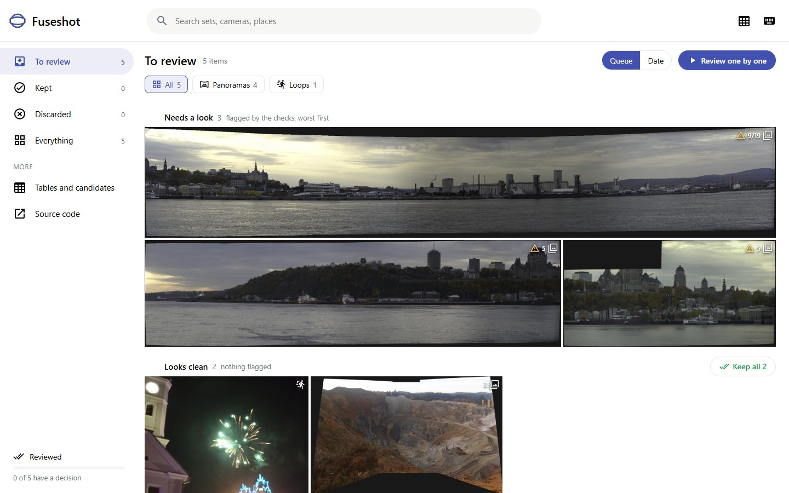
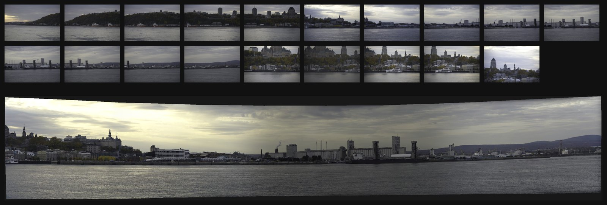
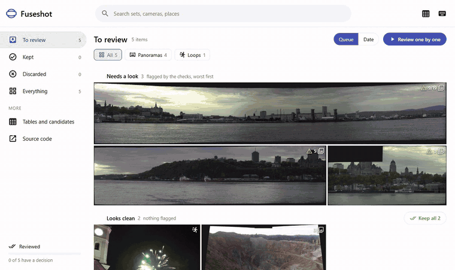
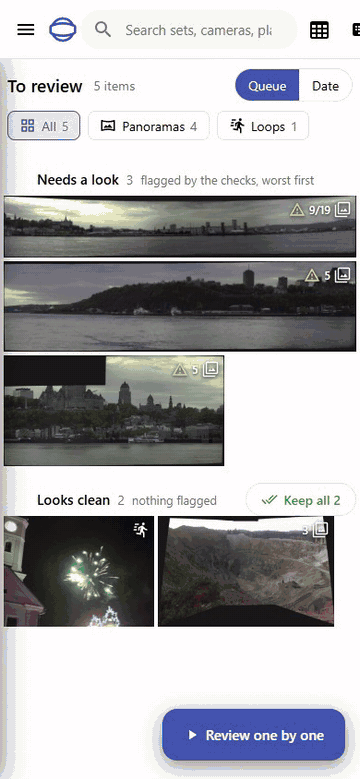
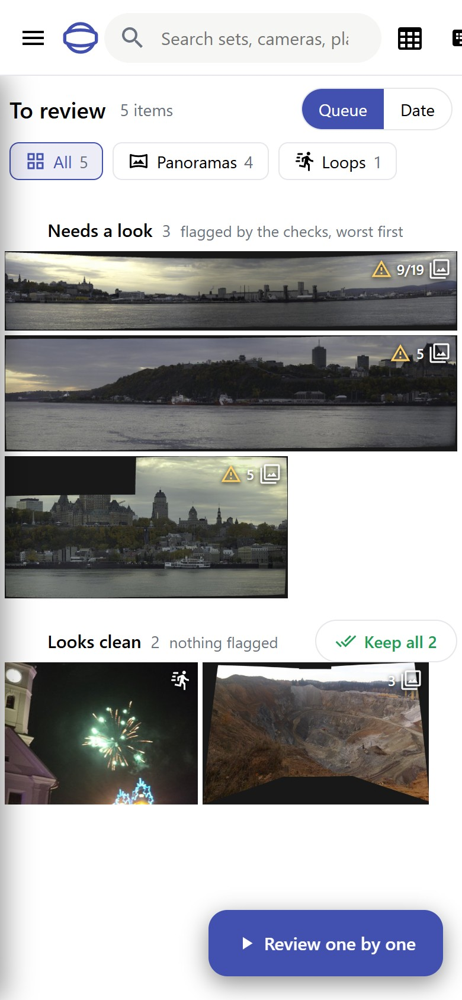
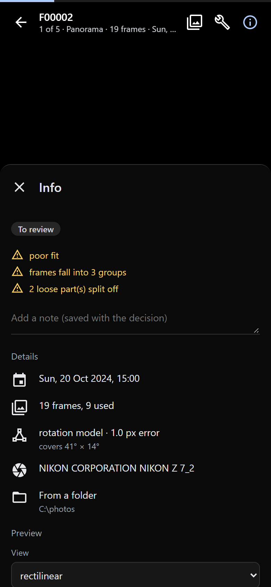
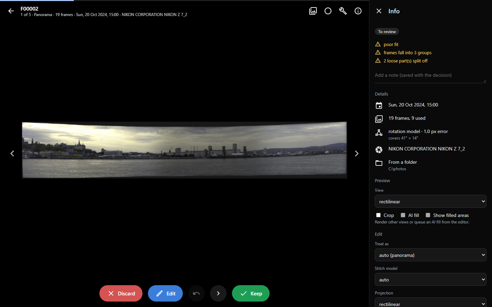

# Fuseshot

Fuseshot looks through your photo library for bursts of shots that belong
together and turns them into something new: panoramas you never stitched, group
photos where everyone has their eyes open, short action loops, and (if you have
a GPU) 3D Gaussian splats you can walk around in. Nothing is changed in your
library. Every result waits on a review page for you to keep or throw away.

It works with [Immich](https://immich.app) or plain folders of photos, runs on
your own machine and talks to nothing but your Immich server.

## What it looks like

The review page, with the sets that need a look first:

Nineteen frames of Quebec City shot from across the river at two zoom levels,
and the wide panorama Fuseshot made from them (the zoomed-in frames became two
smaller panoramas of their own):

Six fireworks shots taken over eight seconds, turned into a loop:

Group shots (several frames merged so everyone has their best face) work the
same way but aren't shown here, since every suitable example has real people
in it.

Reviewing with the keyboard (K keep, D discard, E edit, Space skip, U undo):

On a phone, swipe right to keep, left to discard, up to edit and down to skip:

A result with its details panel open:

All the photos are public domain (CC0) from Wikimedia Commons; see
[docs/media/CREDITS.md](docs/media/CREDITS.md).

## What it does

1. **Finds sets.** It reads photo metadata (time, camera, lens, focal length,
   exposure, GPS) and groups shots taken seconds apart with the same camera. A
   first guess at what each set is (panorama, walk, object scan, group shot,
   action) comes from the metadata alone.
2. **Checks them.** It matches features between the small previews of each set
   to see how the photos really overlap, and drops sets that don't.
3. **Makes things.** Panoramas are stitched with [Hugin](https://hugin.sourceforge.io)
   in several projections. Group shots get each person's best face. Action
   sequences become looping animations. Scans with enough parallax can be posed
   with COLMAP and trained into a splat with Brush.
4. **Lets you choose.** A local web page shows every result with the photos it came
   from. You keep it, discard it, or edit it: another projection, stitching
   model, crop or AI fill makes a new version to look at again.

## Rough parts

This started as a tool for one person's library, and it shows in places:

- The detector is tuned on one library from a handful of phones and cameras.
  Expect some missed sets and some odd guesses; the review page is the safety net.
- AI fill for panorama edges (LaMa) works at about 1500 px and is scaled up, so
  filled areas look soft next to the real photo.
- Splats are experimental: they need a CUDA GPU, COLMAP 3.12 or newer and Brush,
  take a long time, and only some sets pose well.
- Walks and other mosaics stitch less reliably than turning on the spot.
- It runs on Windows and Linux. macOS is not supported.

## Install

Pick one.

**pip** (Python 3.11 or newer):

    pipx install fuseshot          # or: pip install fuseshot
    fuseshot doctor                # shows what is missing and how to get it

From a copy of this repository, `pipx install .` instead. If pipx says its
folder is not on your PATH, run `pipx ensurepath` and open a new terminal.

Stitching needs Hugin's command line tools: `apt install hugin-tools enblend enfuse`
on Linux, or the 64-bit installer from [hugin.sourceforge.io](https://hugin.sourceforge.io/download/)
on Windows (Fuseshot finds it in `C:\Program Files\Hugin`). The extras are optional:

- AI fill: `pipx inject fuseshot torch` (or `pip install 'fuseshot[fill]'`).
  It runs without a GPU, slowly.
- Group shots: `pipx inject fuseshot mediapipe` (or `pip install 'fuseshot[group]'`).
- JPEG XL photos: `pipx inject fuseshot pillow-jxl-plugin` (or `fuseshot[jxl]`).
- Splats: COLMAP 3.12 or newer, Brush and a CUDA GPU.

`fuseshot doctor` says which of these are there, and which NVIDIA card it found.
[docs/quick-start.md](docs/quick-start.md) walks through a first run, Google
Takeout exports, the formats it reads, the graphics card setup and the
`--workers` / `--memory-mb` limits.

**Docker, next to Immich:** copy [compose.example.yml](compose.example.yml) into
your Immich folder and follow the comments at the top. The image has Hugin
included; it does not include COLMAP, Brush, AI fill or group shots. To build
the image yourself, run `docker build -t fuseshot .` in a copy of this
repository.

**Windows:** download the zip from the releases page, unpack it anywhere and run
`fuseshot.exe`. It opens the review page. Install
[Hugin](https://hugin.sourceforge.io/download/) for stitching.

## Setting it up

The quickest way is the review page itself: run `fuseshot review --open` and,
with nothing set up yet, it opens on a setup page. Give it your Immich address
and API key (with a button to test them) or pick photo folders, and choose what
to make: panoramas, object scans, action loops, group shots, wigglegrams and
action composites. Each shows whether the tools it needs are installed, and how
to add them if not. Then start the first scan from the same page. Later it is
under Settings in the sidebar.

The API key is saved to `secrets/immich_key` in the home folder, never to
`fuseshot.toml`, and the page never shows it again. Settings can be changed only
from the computer Fuseshot runs on, or from anywhere once the page has a token
(below); behind a reverse proxy every visitor looks local, so set a token there.

The rest of this section does the same from the command line.

## Use with Immich

1. In Immich, go to Account Settings, API Keys and create a key with only
   `asset.read`, `asset.statistics`, `asset.view` and `asset.download`. That is
   all Fuseshot needs unless you turn on uploads (below).
2. Give it to Fuseshot, either as `FUSESHOT_IMMICH_KEY` in the environment or in
   a file called `secrets/immich_key` in Fuseshot's home folder (`fuseshot doctor`
   prints where that is). If Immich is not at `http://127.0.0.1:2283`, set
   `FUSESHOT_IMMICH_URL`.
3. Run it:

        fuseshot run                   # fetch metadata, find sets, check them, stitch
        fuseshot review --open         # look at the results

`run` is safe to repeat: it only fetches what changed and only stitches what is
new. It also makes loops of the action shots it finds (`--no-loops` to skip
that). `fuseshot run --no-stitch` stops after checking, and `-n` shows the
sources, folders and steps without doing anything.

### Uploading results to Immich

Off by default: Fuseshot only reads from Immich until you add this to
`fuseshot.toml`:

    [upload]
    immich = true
    album = "Fuseshot"     # or "" for no album

Then each result you keep on the review page goes to Immich as a new photo
about 30 seconds later (time to undo). To send the ones you kept earlier, run
`fuseshot export --immich --upload` (`-n` lists them first). This works without
the setting too.

- Uploads only ever add photos. The photos a result was made from are never
  changed or deleted, and Fuseshot never removes anything it uploaded.
- Each upload carries the date and place of the first photo in its set and a
  description saying what Fuseshot did ("Panorama stitched by Fuseshot from 6
  photos"). Panoramas with AI-filled edges say so.
- `work/uploads.json` records what went up, so nothing is sent twice. Splats are
  not uploaded, since Immich cannot show them.

The key then needs `asset.upload` as well, plus `album.read`, `album.create` and
`albumAsset.create` if you use an album:

| Mode | Permissions |
| --- | --- |
| Read only (default) | `asset.read`, `asset.statistics`, `asset.view`, `asset.download` |
| Uploads, no album | the above and `asset.upload` |
| Uploads into an album | the above and `album.read`, `album.create`, `albumAsset.create` |

## Use with folders

    fuseshot --source folder:~/Pictures/Camera --recursive run
    fuseshot review --open

Folders are only read; nothing is written beside your photos. Kept results
are copied to `Pictures/Fuseshot` in your user folder (or `--output-folder`) as
soon as you keep them, and `fuseshot export` copies them all again.

To skip `--source` every time, run `fuseshot init`: it asks for the folders
and the output folder and saves them. Or put them in `fuseshot.toml` in the
home folder yourself (`fuseshot doctor` shows where that is):

    [[sources]]
    type = "folder"
    path = "~/Pictures/Camera"
    recursive = true

Immich and folders can be mixed; see [fuseshot.example.toml](fuseshot.example.toml).
`fuseshot watch --detect` keeps folders up to date as new photos arrive.

### Trying it on sample photos

Nine frames of a street corner at night and the fireworks from the pictures
above, about 20 MB:

    mkdir -p ~/fuseshot-samples && cd ~/fuseshot-samples
    base=https://commons.wikimedia.org/wiki/Special:FilePath
    for n in 1 2 3 4 5 6 7 8 9; do
      curl -fsSL -o "wall-street-$n.jpg" "$base/23_Wall_Street_00$n.JPG"
    done
    for n in 1 2 3 4 5 6; do
      curl -fsSL -o "fireworks-$n.jpg" \
        "$base/New_Year's_fireworks_in_Gliwice,_Silesian_Voivodeship,_Poland,_December_2024_January_2025_($n).jpg"
    done
    fuseshot --source folder:~/fuseshot-samples run
    fuseshot review --open

That gives one panorama from all nine frames and one loop. The photos are
credited in [docs/media/CREDITS.md](docs/media/CREDITS.md). The Steinach and
Quebec photos used in the pictures above are not in the recipe: two of the
Steinach frames were taken almost a minute apart, so Fuseshot splits the sweep
there, and the Quebec photos have no camera details.

## Running it on a server

The review page listens on `127.0.0.1:8765` and has no accounts. To reach it from
other machines:

- Set a token: `fuseshot review --host 0.0.0.0 --token <long random string>` (or
  `FUSESHOT_REVIEW_TOKEN`). Open the address it prints once; the token is
  swapped for a cookie.
- Better, put it behind the reverse proxy or VPN you already use for Immich, and
  give it a path with `--base-path /fuseshot`. For Caddy:

        handle /fuseshot/* {
            reverse_proxy 127.0.0.1:8765
        }

Without a token, the settings page is read-only to anyone who is not on the same
computer, including anyone coming in through a proxy. The page only accepts changes sent from itself, never serves files outside its own
folders, and only writes to Fuseshot's home folder.

## Privacy

Fuseshot runs locally. It reads from your Immich server and your photo folders,
and writes only to its home folder and, for kept results from folders, the output
folder. Uploads, if you turn them on, add new photos to Immich and nothing
else. The only other network traffic is downloading the viewer scripts and
models it needs from npm, GitHub and Google's model storage, each checked against a
pinned SHA-256 (see [THIRD_PARTY.md](THIRD_PARTY.md)). There is no telemetry.

## More

- [How it works](docs/how-it-works.md): detection, overlap checks, stitching,
  groups, loops and splats in detail, and every command.
- [Configuration](docs/configuration.md): the settings file, environment
  variables, outside programs and job queues.
- [Contributing](CONTRIBUTING.md), [security](SECURITY.md), [changes](CHANGELOG.md).

## License

Fuseshot is free software under the [GNU AGPL v3 or later](LICENSE). In short:
use it however you like, and if you share a modified version, or let other
people use one over a network, offer them its source too. The review page links to
the source for that reason; if you run a modified copy for others, point the link
at your version. Bundled and downloaded third-party parts keep their own licenses,
listed in [THIRD_PARTY.md](THIRD_PARTY.md).
